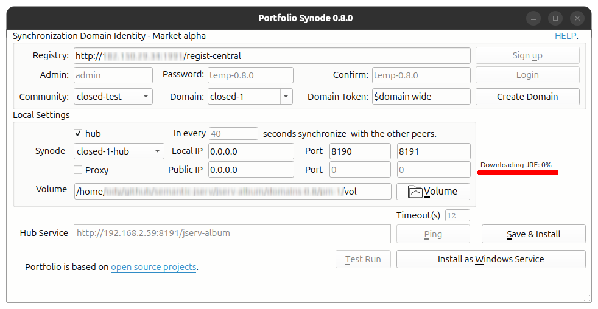

Tips
====

Downloading JRE Halt (From China)
---------------------------------

Portfolio is using JRE 17, which is downloaded from Github while installation.

Frequently, downloading resouces from Gihub is blocked with any tools like Wget,
Curl or pragrammally. The downloading progress can be halt at 0% infinitely.

If you can download files from Github within a browser or someother ways, download
and place it in the jre-temp folder, restart setup-gui should solve the problem.

To download the correct JRE, find the link in the terminal Window. Say::

    JRE: ('OpenJDK17U-jre_x64_linux_hotspot_17.0.17_10.tar.gz', False, False, 'jdk-17.0.17+10-jre')
    Downloading JRE for Linux x86_64
    https://github.com/adoptium/temurin17-binaries/releases/download/jdk-17.0.17%2B10/OpenJDK17U-jre_x64_linux_hotspot_17.0.17_10.tar.gz 

Place the download file, e.g. *OpenJDK17U-jre_x64_linux_hotspot_17.0.17_10.tar.gz* into the jre-temp folder,
restart the installer should skip the downloading.

If you also cannot download with other tools, please contact the author.
