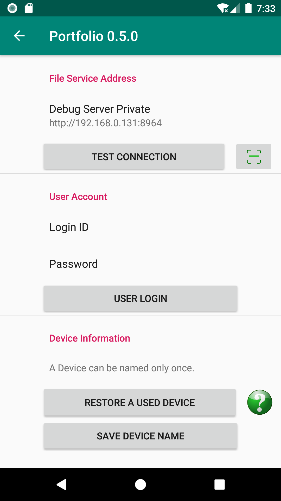

快速入门
========

前提条件
--------

Portfolio Android 客户端会把文件上传到域中的任一服务器，这些服务器通常作为社区的文件服务器部署。服务节点必须已经设置好。

参见 :ref:`如何安装私有文件服务器 Portfolio Synode <setup-synode>`。

.. _setup_android:

设置 Portfolio Android
----------------------

服务器安装完成且服务启动后，打开 Portfolio Android，在设置页面中设置设备 ID 和用户 ID。

..

- 设置设备名称

Portfolio 使用设备名称区分来自不同来源的文件。用户必须为设备取一个在文件服务器所在域中唯一的名称。

- 登录

使用服务器管理员设置的用户 ID 和密码登录。登录成功后，请返回主页。

上传文件
--------

在主页点击 *Add ...* 按钮，选择并上传文件。
