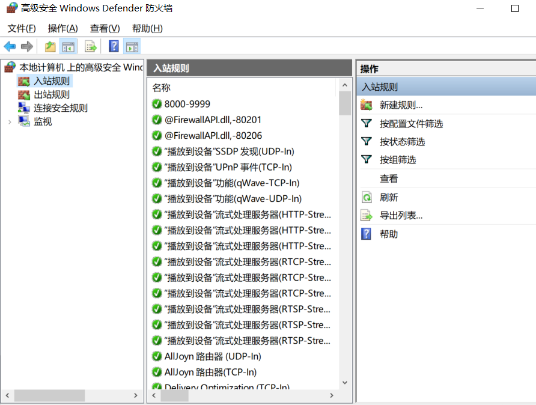
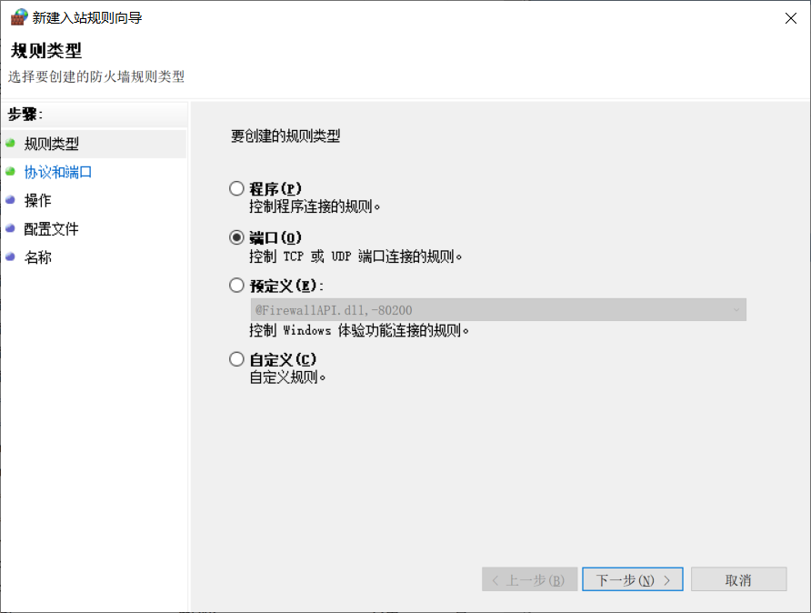
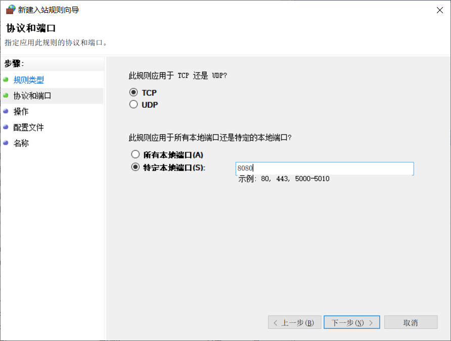
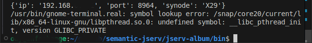

故障排除
========

- 外部管理環境錯誤（PEP 668）

使用以下命令安裝 Portfolio 時::

  pip install bin/synode_py3-0.7-py3-none-any.whl 

可能會出現 externally-managed-environment 錯誤。以下是 Ubuntu 24.04、Python 3.12（Pip 24）下的示例：

::

  error: externally-managed-environment

  × This environment is externally managed
  ╰─> To install Python packages system-wide, try apt install
      python3-xyz, where xyz is the package you are trying to
      install.
      
      If you wish to install a non-Debian-packaged Python package,
      create a virtual environment using python3 -m venv path/to/venv.
      Then use path/to/venv/bin/python and path/to/venv/bin/pip. Make
      sure you have python3-full installed.
      
      If you wish to install a non-Debian packaged Python application,
      it may be easiest to use pipx install xyz, which will manage a
      virtual environment for you. Make sure you have pipx installed.
      
      See /usr/share/doc/python3.12/README.venv for more information.

  note: If you believe this is a mistake, please contact your Python
  installation or OS distribution provider. You can override this, at
  the risk of breaking your Python installation or OS, by passing
  --break-system-packages.

  hint: See PEP 668 for the detailed specification.

這是 Pip 在提示不要把 Portfolio 安裝到系統的 python3 路徑中。請建立虛擬環境後再安裝::

   sudo apt install python3.12-venv # replace the version number
   python3 -m venv .env
   source .env/bin/activate

Portfolio 0.7.6 只在安裝時需要 Python3；安裝完成後就不再需要 Python 環境。

.. _uninstall_winsrv_manually:

- 手動解除安裝 Windows 服務

**不推薦這樣做**

服務應當使用上文的命令解除安裝。如果必須手動解除安裝 Windows 服務，請按以下步驟操作：

#. 複製並備份 *WEB-INF/settings.json*

#. 如果有檔案損壞，請把 Portfolio-synode 重新安裝到同一資料夾，並確保版本號與之前安裝的相同。

#. 從開始選單開啟 Windows 服務控制面板，檢視兩個服務的名稱，應類似於::

    Synode.web-0.8.0-X29
    Synode-0.8.0-X29

  開啟 *WEB-INF/settings.json* 檔案，把 Synode ID 填入 *"envars"* 部分，例如::

    "envars": {
        "winsrv.web": "Synode.web-0.8.0-X29",
        "winsrv.synode": "Synode-0.8.0-X29"
        ...
    }

#. 以管理員身份開啟 CMD 終端，進入安裝資料夾。

#. 執行 synode-uninstall.exe

#. 如有需要，重新整理 Windows 服務控制面板。

- PIP 無法為 Python 3.12 或更高版本解析 Pillow 版本

錯誤資訊類似::

  $ pip install bin/synode_py3-0.7-py3-none-any.whl 
  Processing ./bin/synode_py3-0.7-py3-none-any.whl
  ...
  INFO: pip is looking at multiple versions of synode-py3 to determine which
  version is compatible with other requirements. This could take a while.
  ERROR: Ignored the following versions that require a different python version: 6.0.0
  Requires-Python >=3.6, <3.10; 6.0.0a1.dev1606911628 Requires-Python >=3.6, <3.10;
  6.0.1 Requires-Python >=3.6, <3.10; 6.0.2 Requires-Python >=3.6, <3.10;
  6.0.3 Requires-Python >=3.6, <3.10; 6.0.4 Requires-Python >=3.6, <3.10;
  ...
  6.5.2 Requires-Python <3.12,>=3.7; 6.5.3 Requires-Python <3.12,>=3.7
  ERROR: Could not find a version that satisfies the requirement psutil
  (from synode-py3) (from versions: none)
  ERROR: No matching distribution found for psutil 

這可能是因為 pip 版本過舊。

在解決這個問題時，我們又遇到了另一個網路問題::

  ERROR: Exception:
  Traceback (most recent call last):
  File "...env-m7/lib/python3.12/site-packages/pip/_vendor/urllib3/response.py", line 438, in _error_catcher
    yield
  File "...env-m7/lib/python3.12/site-packages/pip/_vendor/urllib3/response.py", line 561, in read
    data = self._fp_read(amt) if not fp_closed else b""
           ^^^^^^^^^^^^^^^^^^
  ...
  File "...env-m7/lib/python3.12/site-packages/pip/_vendor/urllib3/response.py", line 443, in _error_catcher
    raise ReadTimeoutError(self._pool, None, "Read timed out.")
  pip._vendor.urllib3.exceptions.ReadTimeoutError: HTTPSConnectionPool(host='files.pythonhosted.org', port=443): Read timed out.

Grok 很肯定這是防火長城（GFW）導致的問題。請使用映象源安裝。

::

    pip install bin/synode_py3-0.7-py3-none-any.whl -i https://pypi.tuna.tsinghua.edu.cn/simple
    
另外，你還有其他選擇，例如向網路服務提供商投訴。

- Windows 網路防火牆 / Defender

在啟用了防火牆的 Windows 上，請確保防火牆設定允許你所設定的連接埠。

`Microsoft 文件 <https://learn.microsoft.com/zh-tw/sql/reporting-services/report-server/configure-a-firewall-for-report-server-access?view=sql-server-ver15#opening-ports-in-windows-firewall>`_

.. _trouble-vscode-linux:

- 在 Linux 的 VS Code 中執行

**僅在 Ubuntu 24.04 上測試過**

在 Ubuntu / Linux 的 VS Code 終端中執行 Portfolio-synode，會出現類似 `問題報告 #179274 <https://github.com/microsoft/vscode/issues/179274>`_ 的錯誤。

可以這樣執行來避免該錯誤::

    export GTK_PATH= && python3 -m portfolio-synode

但由於未經充分測試，強烈不建議這樣做。

.. _trouble-exiftool-by-auto-update:

Ubuntu 自動更新導致的問題
-------------------------

**僅發生在啟用了自動更新的 Linux 上**

如果在 Linux（在 Ubuntu 24.04 上測試）上設定的系統服務使用的是由系統自動更新管理的 JDK，那麼當正在執行的服務的 JDK 版本與最新版本不同時，就會出錯。

服務日誌如下::

  Incorrect Java version: 21.0.7+6-Ubuntu-0ubuntu124.04
  jspawnhelper version 21.0.8+9-Ubuntu-0ubuntu124.04.1
  This command is not for general use and should only be run as the result of a call to
  ProcessBuilder.start() or Runtime.exec() in a java application
  java.io.IOException: Cannot run program "exiftool": error=0, Failed to exec spawn helper: pid: >
    at java.base/java.lang.ProcessBuilder.start(ProcessBuilder.java:1170)
    at java.base/java.lang.ProcessBuilder.start(ProcessBuilder.java:1089)
    at java.base/java.lang.Runtime.exec(Runtime.java:681)
    at java.base/java.lang.Runtime.exec(Runtime.java:530)
    at io.oz.album.helpers.Exiftool.parse(Exiftool.java:117)
    at io.oz.album.helpers.Exiftool.parseExif(Exiftool.java:62)
    at io.oz.syntier.serv.DocreateHandler.onCreate(DocreateHandler.java:57)
    at io.oz.jserv.docs.syn.ExpDoctier.lambda$endBlock$1(ExpDoctier.java:417)
    at java.base/java.lang.Thread.run(Thread.java:1583)
  Caused by: java.io.IOException: error=0, Failed to exec spawn helper: pid: 546376, exit value: 1
    at java.base/java.lang.ProcessImpl.forkAndExec(Native Method)
    at java.base/java.lang.ProcessImpl.<init>(ProcessImpl.java:295)
    at java.base/java.lang.ProcessImpl.start(ProcessImpl.java:225)
    at java.base/java.lang.ProcessBuilder.start(ProcessBuilder.java:1126)
    ... 8 more

正在執行的 JDK 是舊版本 20.0.7_6，它會用較新的 21.0.8+9 版本來派生程序。由於 jspawnhelper 加強了版本檢查 [1]，啟動 *exiftool* 程序會失敗。

Apt 更新日誌::

  openjdk-21 (21.0.8+9~us1-0ubuntu1~24.04.1) noble-security; urgency=medium

    * Upload to Ubuntu 24.04.
    * CVEs:
      - CVE-2025-50059, 8350991: Improve HTTP client header handling
      - CVE-2025-30749, 8348989: Better Glyph drawing
      - CVE-2025-50106, 8360147: Better Glyph drawing redux
      - CVE-2025-30754, 8349594: Enhance TLS protocol support
    * Security fixes:
      - 8349111: Enhance Swing supports
      - 8345625: Better HTTP connections

  -- Vladimir Petko <vladimir.petko@canonical.com>  Thu, 17 Jul 2025 09:55:59 +1200

  ...

  openjdk-21 (21.0.7+6-1) unstable; urgency=high

    * OpenJDK 21.0.7 release, build 6.
      - Addresses CVE-2025-30698, CVE-2025-30691, CVE-2025-21587.

    * Honour DEB_BUILD_OPTIONS=parallel=N while running jtreg tests (Helmut
      Grohne). Addresses: #1095920.

  -- Matthias Klose <doko@ubuntu.com>  Thu, 24 Apr 2025 01:57:46 +0200

[1] *Improve jspawnhelper version checks*，JDK-8325621，影響版本：11、17、21、22、23，
    https://bugs.openjdk.org/browse/JDK-8325621

.. _install-anson-py3:

- 安裝 portfolio-synode 失敗
  
  [已在 Portfolio 0.7.6 中解決]

  錯誤::

    ERROR: Could not find a version that satisfies the requirement anson.py3 (from portfolio-synode) (from versions: none)

  Portfolio-synode 依賴一個尚未釋出到 PyPI 的模組。請使用以下命令安裝：

    pip install --index-url https://test.pypi.org/simple --extra-index-url https://pypi.org/simple anson.py3

  如果需要移除由舊版 Python（例如 python 3.9）安裝的包，請用以下命令解除安裝::

    pip3.9 uninstall portfolio-synode 
